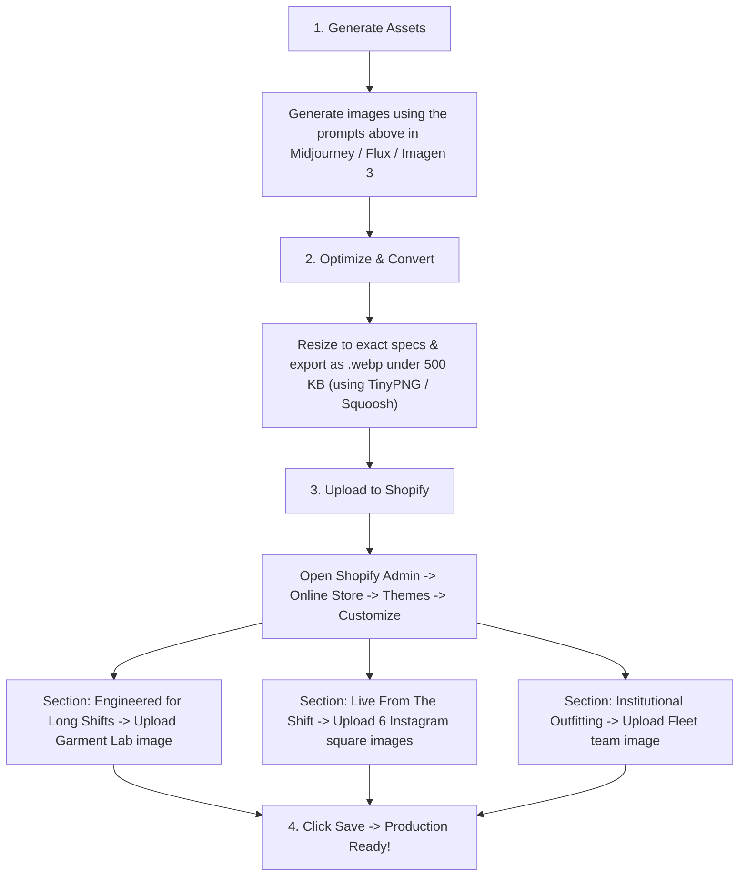

# 🩺 Kapisa Healthcare Luxury Apparel — Production Image Generation Guide

> [!IMPORTANT]
> **Production Launch Replacement Guide**: This document covers **ONLY** the 3 newly built sections that currently use temporary Unsplash placeholder images. Replace these images before going live with your AI-generated or studio assets.

---

## 🎨 Global Brand Visual Rules
All generated images must adhere to Kapisa's luxury medical brand language:
- **Scrub Color**: Deep Midnight Navy (`#0E1F3C`) with subtle Royal Gold thread monogram/embroidery (`#C9A227`).
- **Aesthetic**: Premium tailored athletic medical wear (comparable to FIGS & Vuori). Sharp draping, 4-way stretch micro-knit texture, not baggy or stiff standard hospital scrubs.
- **Talent**: Professional, confident Indian and global doctors, surgeons, chief residents, and trauma nurses.
- **Lighting**: Commercial editorial lighting, crisp fabric micro-texture, subtle rim lighting, natural clinical warmth.

---

## 1. Feature Highlights — Garment Lab Explorer (`blocks/feature-highlights.liquid`)

### Where to Upload in Shopify:
- In Shopify Theme Editor: Navigate to the **"Engineered for Long Shifts"** section -> Setting: **"Garment lab model image"** (`feature_image`).
- **Currently Using**: Temporary Unsplash placeholder of doctor holding phone.

### Image Specifications:
- **Aspect Ratio**: `4:5` (or `1:1.15`).
- **Recommended Dimensions**: **2400 × 2800 px** (min 1600 × 2000 px).
- **Format**: `.webp` (or high-quality `.png`), under 500 KB.
- **Composition & Framing**: 
  - 3/4 standing shot of an athletic clinician wearing the **Midnight Navy Scrub Set**.
  - Visible from neck/shoulders down to mid-thigh/knees.
  - Leaves the center chest, shoulders, side waist, and pockets clearly exposed because the 4 interactive animated hotspot pins overlay directly over these areas:
    - **Hotspot 01 (Upper Chest / Shoulder)**: 4-Way Stretch Flex Zone
    - **Hotspot 02 (Chest Pocket)**: Custom Monogram Embroidery Pocket
    - **Hotspot 03 (Side Torso)**: Breathable Airflow Zone
    - **Hotspot 04 (Trouser / Pocket)**: 6-Pocket Storage & Anti-Odor Fabric
- **Background**: Modern deep navy clinical research lab or dark architectural gradient studio backdrop (`#0E1F3C` to `#081528`) with cinematic cool blue and warm gold rim lighting.

### Copy-Paste AI Prompt (Midjourney v6 / Gemini Imagen 3 / Flux):
```text
Commercial 3/4 portrait of an athletic 32-year-old male doctor standing with natural confidence in a modern clinical research environment, wearing a premium tailored midnight navy blue medical scrub set (V-neck top and slim-cut scrub pants). A high-end black acoustic stethoscope hangs comfortably around his neck. Hands relaxed at his sides showing deep trouser pocket lines and tailored silhouette. Intricate 4-way stretch textile weave visible on the fabric, precise double-needle stitching along the shoulders, and subtle gold embroidered monogram emblem on the left chest pocket. Cinematic architectural lighting with subtle warm amber and soft cyan rim lights separating him from a dark moody navy studio background. Ultra-sharp 8k, Phase One 150MP, 85mm lens at f/4, photorealistic apparel catalogue photography --ar 4:5 --style raw
```

---

## 2. "Live From The Shift" — Instagram Community Grid (`blocks/instagram-feed.liquid`)

### Where to Upload in Shopify:
- In Shopify Theme Editor: Navigate to the **"Live From The Shift"** section -> Settings: **"Shift photo 1"** through **"Shift photo 6"** (`image_1` to `image_6`).
- **Currently Using**: 6 temporary Unsplash lifestyle photos.

### Image Specifications:
- **Aspect Ratio**: `1:1` Square.
- **Recommended Dimensions**: **1200 × 1200 px** each.
- **Format**: `.webp` (under 300 KB each).
- **Style**: High-end social media lifestyle photography (iPhone 16 Pro / Leica M aesthetic) showing authentic hospital life and pride in wearing Kapisa scrubs.

### Copy-Paste AI Prompts (6 Distinct Tiles):

#### Tile 1 — Operating Theater Corridor (Surgeon Pre-Op)
- **Shopify Setting**: `image_1` ("Shift photo 1")
- **Tag Label**: `@Dr.Arjun_Surgeon`
```text
Square candid lifestyle photograph of a confident 35-year-old Indian male general surgeon walking through an illuminated modern hospital surgical suite hallway. He is wearing a tailored midnight navy Kapisa scrub top with a matching surgical scrub cap and an ID lanyard. Arms relaxed, smiling warmly at the camera. Soft fluorescent clinical lighting mixed with warm architectural corridor downlights. Crisp realistic fabric texture, shot on Leica Q3, 35mm f/2, authentic hospital shift moment --ar 1:1 --style raw
```

#### Tile 2 — Nursing Station Coffee Break (Resident Doctor)
- **Shopify Setting**: `image_2` ("Shift photo 2")
- **Tag Label**: `@Priya_TraumaRN`
```text
Square candid portrait of an energetic 27-year-old female medical resident with her hair neatly tied back, wearing a sleek tailored midnight navy scrub top with personalized gold chest embroidery. She is holding a ceramic coffee mug at a bright modern ICU nursing station with monitors softly blurred in the background. Genuine candid smile during a shift break. Natural morning sunlight through hospital window. Canon EOS R5, 50mm f/1.8, editorial lifestyle --ar 1:1 --style raw
```

#### Tile 3 — Macro Fabric & Custom Gold Embroidery Detail
- **Shopify Setting**: `image_3` ("Shift photo 3")
- **Tag Label**: `@KapisaClinical`
```text
Macro extreme close-up commercial product photograph of high-grade midnight navy 4-way stretch scrub fabric. Intricate metallic royal gold thread embroidery crisply stitched onto the chest reading "Dr. R. Kapoor, MS — Cardiology". Ultra-detailed micro-knit fabric weave, precision seams, soft directional studio lighting catching the metallic shimmer of the gold thread. Shallow depth of field, 8k resolution, Hasselblad 120mm macro f/4 --ar 1:1 --style raw
```

#### Tile 4 — Stethoscope Fit & Active Mobility
- **Shopify Setting**: `image_4` ("Shift photo 4")
- **Tag Label**: `@Dr_Dev_Neuro`
```text
Square medium shot of a young male neurologist adjusting a black matte Littmann stethoscope around his neck while wearing a fitted midnight navy Kapisa V-neck scrub top. Focus on the athletic drape and flexibility of the scrubs across the shoulders and chest. Clean, minimalist hospital hallway backdrop with soft bokeh. Editorial medical fashion portrait, natural skin tones, soft studio rim light, Hasselblad 85mm f/2.8 --ar 1:1 --style raw
```

#### Tile 5 — Multi-Disciplinary Doctor Huddle (ER Team)
- **Shopify Setting**: `image_5` ("Shift photo 5")
- **Tag Label**: `@Apollo_ER_Team`
```text
Square lifestyle photo of two young healthcare professionals (one male physician and one female senior nurse) reviewing digital chart notes on a tablet computer in a modern hospital triage reception. Both wearing matching tailored midnight navy scrubs with gold monogram accents. Engaged, collegial expressions. Bright, clean medical facility background with natural diffused lighting. Shot on Sony A7R V, 35mm f/2, authentic collaborative healthcare shift --ar 1:1 --style raw
```

#### Tile 6 — Pediatric / Ward Clinician Smile
- **Shopify Setting**: `image_6` ("Shift photo 6")
- **Tag Label**: `@Dr.Meera_Peds`
```text
Square warm lifestyle portrait of a friendly 30-year-old female pediatrician wearing a royal navy Kapisa scrub top with custom gold pocket embroidery, smiling warmly in a bright modern clinic room. A colorful pediatric stethoscope badge reel is clipped to her pocket. Welcoming, empathetic demeanor. Soft daylight illumination, natural depth of field, sharp fabric details, shot on 50mm lens f/2 --ar 1:1 --style raw
```

---

## 3. Institutional Fleet & Hospital Outfitting (`blocks/bulk-order-banner.liquid`)

### Where to Upload in Shopify:
- In Shopify Theme Editor: Navigate to the **"Outfitting India’s Leading Healthcare Institutions"** section -> Setting: **"Custom department outfitting mockup"** (`mockup_image`).
- **Currently Using**: Temporary Unsplash photo of medical team.

### Image Specifications:
- **Aspect Ratio**: `4:3` (or `1:1.1`).
- **Recommended Dimensions**: **1600 × 1200 px** (or 2000 × 1500 px).
- **Format**: `.webp` (under 450 KB).
- **Composition & Framing**: 
  - A cohesive team of 3 to 4 healthcare leaders (Senior Surgeon, Chief Resident, Head of Nursing) standing together in an elite hospital lobby or executive medical boardroom.
  - All wearing matching **Midnight Navy tailored Kapisa scrubs** with unified gold institutional chest embroidery.
  - Shows organizational prestige, premium team identity, and executive hospital quality.
- **Background**: Architectural glass and marble hospital atrium, warm recessed ceiling lights, prestigious medical center aesthetic.

### Copy-Paste AI Prompt:
```text
Cinematic commercial photograph of a unified medical leadership team of three healthcare professionals (a male senior surgeon, a female chief of emergency medicine, and a female clinical coordinator) standing proudly together in the spacious atrium of a world-class architectural hospital. All three wear matching premium tailored midnight navy Kapisa scrubs with custom royal gold embroidered hospital crests and personalized names on the chest. The surgeon has arms folded with quiet confidence; the emergency physician holds an iPad medical folio. Polished marble floors reflecting warm ambient downlights, towering glass facade in background with soft architectural bokeh. Authoritative, luxurious, world-class institutional medical prestige. Arri Alexa Mini LF, Zeiss Supreme Prime 40mm at f/3.2, 8k resolution, commercial advertising photography --ar 4:3 --style raw
```

---

## 🚀 Step-by-Step Replacement Workflow



---

## 📁 Recommended SEO Filename Cheatsheet

| Target Section | Recommended Filename | Dimensions |
| :--- | :--- | :--- |
| **Garment Lab Explorer** | `kapisa-midnight-navy-scrub-hotspot-lab.webp` | 2400 × 2800 px |
| **Shift Tile 1** | `kapisa-instagram-surgeon-shift-or.webp` | 1200 × 1200 px |
| **Shift Tile 2** | `kapisa-instagram-resident-icu-coffee.webp` | 1200 × 1200 px |
| **Shift Tile 3** | `kapisa-instagram-gold-embroidery-macro.webp` | 1200 × 1200 px |
| **Shift Tile 4** | `kapisa-instagram-stethoscope-active-fit.webp` | 1200 × 1200 px |
| **Shift Tile 5** | `kapisa-instagram-er-team-collaboration.webp` | 1200 × 1200 px |
| **Shift Tile 6** | `kapisa-instagram-pediatric-clinician.webp` | 1200 × 1200 px |
| **Fleet / Institutional** | `kapisa-hospital-fleet-bulk-outfitting.webp` | 1600 × 1200 px |
